# Diego Figueiredo Silva | D1 = 5 | D2 = 0 | N = 3

**Ponderada CC08: do pipeline ao deadlock.** Prof. João Luisi.

Diego (5) + Figueiredo (10) + Silva (5) = 20 letras, então D1 = 5 e D2 = 0.

| Parâmetro | Conta | Valor |
|---|---|---|
| IC | 100.000 + 20.000 × 0 | 100.000 instruções por amostra |
| m | 3% + 0,5% × 5 | 5,5% |
| N | 3 + (0 mod 5) | 3 posições |

Uma ideia guia este trabalho: **5 ms é uma promessa sobre o pior caso, não sobre a média.** Por isso, depois de responder cada questão, testo até onde a resposta aguenta. Foi o que mudou as minhas conclusões:

1. Na conta, a Plataforma V passa. Mas os "até 3 ms" do Linux chegaram a 8,13 ms quando medi no meu notebook (A1).
2. No pior caso, o chip de 48 MHz com DSP aguenta mais instruções que o de 1,2 GHz, por pouco mais da metade do preço (A1).
3. No ritmo real da pulseira, a versão com deadlock passa 200 s de teste. Uma pausa de 50 ms do motor a congela para sempre (A4).
4. A correção de livro para o deadlock, a ordem global, resolveria o travamento, mas faria o sensor perder o prazo (A5).
5. O argumento da parceira não resiste à medida: processo separado custa 0,1 µs a mais que thread (Parte B).

Contas e diagramas foram conferidos por programa (`codigo/extras/`). Onde escrevo "medido", o número veio do meu notebook, um i5-1345U com Linux 7.0, e não do hardware da pulseira. As saídas cruas estão em `codigo/resultados/`, e `bash extras/medir_tudo.sh` repete tudo. Os prints são essas saídas reais, convertidas em imagem.

---

# Parte A: o problema técnico

## A1. Arquitetura e memória: qual processador vai na pulseira?

### 1. Plataforma H

```text
T = IC × CPI ÷ f
T = 100.000 × 1,5 ÷ 48.000.000 Hz
T = 150.000 ciclos ÷ 48.000.000 Hz = 3,125 ms
```

**Atende:** 3,125 ms ≤ 5 ms, com folga de 1,875 ms. Como não há cache nem sistema operacional, esse tempo não varia: o pior caso é igual ao caso médio.

### 2. Plataforma V

```text
AMAT = acerto + m × penalidade
AMAT = 1 + 0,055 × 120 = 7,6 ciclos

CPI efetivo = 1,0 + (acessos por instrução × m × penalidade)
CPI efetivo = 1,0 + (1,3 × 0,055 × 120) = 1,0 + 8,58 = 9,58

T = 100.000 × 9,58 ÷ 1.200.000.000 Hz
T = 958.000 ciclos ÷ 1,2 GHz = 0,798 ms

Pior caso = 0,798 ms + 3 ms = 3,798 ms
```

**Atende:** 3,798 ms ≤ 5 ms, com folga de 1,202 ms. Dos 9,58 ciclos de cada instrução, 8,58 são espera pela memória: cerca de 90% do tempo, o processador de 1,2 GHz está parado.

### 3. DSP na Plataforma H (Lei de Amdahl)

```text
S = 1 ÷ ((1 − F) + F ÷ k)
S = 1 ÷ ((1 − 0,6) + 0,6 ÷ 5)
S = 1 ÷ (0,4 + 0,12) = 1 ÷ 0,52 = 1,923

T novo = 3,125 ms ÷ 1,923 = 1,625 ms
```

**Atende, e já atendia sem o DSP.** Com o meu IC, ele não é necessário para cumprir o prazo: compra folga, que passa de 1,875 ms para 3,375 ms. Mesmo um DSP infinitamente rápido pararia em S = 1 ÷ 0,4 = 2,5, porque 40% do tempo fica fora dele.

### 4. Por que a V precisa de cache e a H não?

Na V, instruções e dados disputam o mesmo caminho até uma DRAM de 120 ciclos: é o gargalo de Von Neumann.  
Sem cache, com 1,3 acessos por instrução, o CPI seria 1 + 1,3 × 120 = 157 e a amostra levaria 13,08 ms.  
A cache guarda perto do processador o que foi usado há pouco e derruba o CPI para 9,58.  
Na H, a SRAM interna responde em 1 ciclo a 48 MHz, no ritmo do processador.  
E a arquitetura Harvard separa instruções e dados. Não existe espera para esconder.

### 5. Evidência da minha máquina

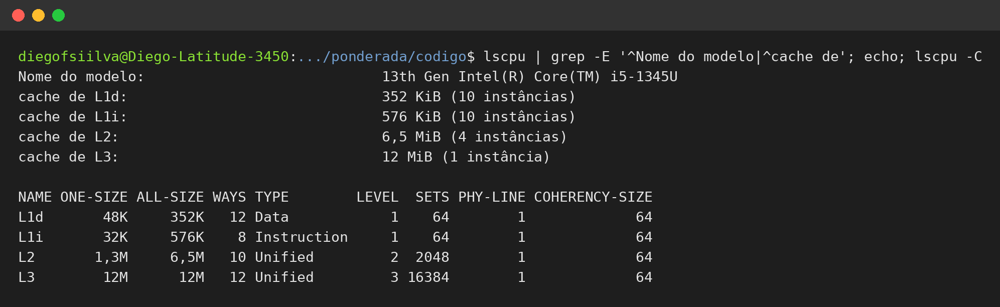

**A minha L1 é dividida:** cada núcleo tem L1d (dados) e L1i (instruções) separadas. Nos núcleos de desempenho são 48 KiB e 32 KiB; nos de eficiência, 32 KiB e 64 KiB. L2 e L3 são unificadas.

**Meu computador é Von Neumann, com uma L1 Harvard.** Instruções e dados moram na mesma RAM e no mesmo espaço de endereçamento: tanto que o sistema carrega um programa como dado antes de executá-lo. A separação só existe no último trecho, perto do núcleo, para que buscar instrução e acessar dado não disputem a mesma porta. É o que se chama de Harvard modificada.

Fui além do print e medi o custo de cada nível (`extras/latencia_cache.c`). É o gargalo de Von Neumann na minha própria máquina:

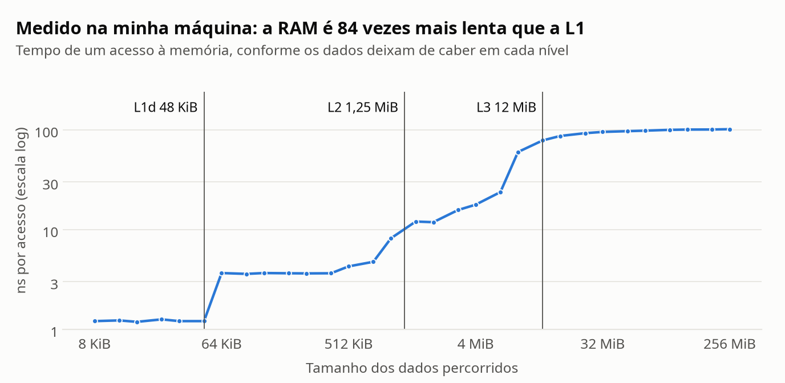

Um acesso à L1 leva 1,2 ns e um acesso à RAM, 101 ns: 84 vezes mais. É a mesma ordem de grandeza da penalidade de 120 ciclos do enunciado, e é por isso que a taxa de falta manda na Plataforma V.

### Até onde essa resposta aguenta

As duas plataformas passam. Mas a conta da V soma o tempo **médio** da amostra ao atraso do sistema, e isso não é um pior caso de verdade: quando o Linux interrompe a tarefa, ele também suja a cache e aumenta m justamente nessa hora.

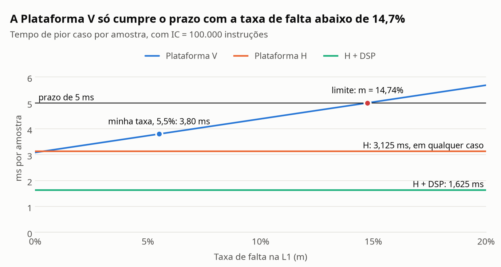

```text
CPI máximo no pior caso = (5 ms − 3 ms) × 1,2 GHz ÷ 100.000 = 24
m máximo = (24 − 1) ÷ (1,3 × 120) = 14,74%
```

A V fura o prazo se a taxa de falta passar de **14,74%**, 2,7 vezes a minha. Na H, essa pergunta nem existe. A tabela compara as três opções até o limite:

| | H | H + DSP | V, pior caso |
|---|---|---|---|
| Tempo por amostra | 3,125 ms | 1,625 ms | 3,798 ms |
| Folga | 1,875 ms | 3,375 ms | 1,202 ms |
| IC máximo em 5 ms | 160.000 | 307.692 | 250.522 |
| Buffer cheio (N × tempo, ver A4) | 9,375 ms, não atende | 4,875 ms, atende | 5,395 ms, não atende |
| Custo por unidade | R$ 22 | R$ 37 | R$ 70 |

A V é 3,9 vezes mais rápida na média (125 contra 32 milhões de instruções por segundo), mas o atraso de 3 ms consome 60% do orçamento antes de ela começar. Por isso, no pior caso, o chip de 48 MHz com DSP aguenta mais instruções que o de 1,2 GHz, por pouco mais da metade do preço.

### E os "até 3 ms" do Linux?

A folga de 1,202 ms depende de esse atraso nunca passar de 3 ms. Testei a premissa com uma tarefa parecida com a do sensor, que acorda a cada 10 ms, trabalha 0,8 ms e dorme (`extras/jitter.c`, 3.000 amostras por cenário):

| Cenário | Atraso mediano | p99 | Máximo | Acima de 1,2 ms | Acima de 3 ms |
|---|---:|---:|---:|---:|---:|
| Máquina parada | 57 µs | 601 µs | 2,68 ms | 5 | 0 |
| Concorrente de mesma prioridade no mesmo núcleo | 629 µs | 639 µs | 2,63 ms | 1 | 0 |
| Concorrente `SCHED_IDLE` no mesmo núcleo | 54 µs | 62 µs | 1,30 ms | 1 | 0 |
| Todos os núcleos ocupados | 86 µs | 3,30 ms | **8,13 ms** | 188 | 79 |

Com a máquina cheia, o Linux comum atrasou a tarefa em 8,13 ms, 2,7 vezes o teto do enunciado, e 79 despertares passaram de 3 ms. Meu notebook não é a pulseira, e um kernel de tempo real deve se sair melhor. Ainda assim, a medida mostra o que "até 3 ms" exige: alguém precisa garantir esse limite por configuração e prová-lo no hardware. Na H, esse trabalho não existe.

A segunda linha da tabela também pesa. Só de dividir o processador com um processo de mesma prioridade, o atraso típico subiu de 54 para 629 µs, e em um teste curto chegou a 939 µs. Com o concorrente em `SCHED_IDLE`, que só roda quando sobra tempo, ele voltou para 54 µs. Essa é a origem da regra de prioridade da A3 e da Parte B.

## A2. Pipeline: o loop do filtro

Numero as instruções de I1 a I7, na ordem do enunciado. Os diagramas abaixo foram gerados por `extras/pipeline.py`. O asterisco marca um ciclo parado naquele estágio.

### 1. Dependências de dados (RAW)

| Instrução | Depende de | Registrador | Distância |
|---|---|---|---|
| I2 `add x6, x6, x5` | I1 `lw x5, 0(x10)` | x5 | 1 |
| I4 `sub x6, x6, x7` | I2 `add x6, x6, x5` | x6 | 2 |
| I4 `sub x6, x6, x7` | I3 `lw x7, 0(x11)` | x7 | 1 |
| I5 `sw x6, 0(x12)` | I4 `sub x6, x6, x7` | x6 | 1 |

### 2. Sem forwarding: 17 ciclos

Quem lê precisa esperar o WB de quem escreve. Como o banco escreve na primeira metade do ciclo e lê na segunda, ID e WB podem cair no mesmo ciclo.

| Instrução | 1 | 2 | 3 | 4 | 5 | 6 | 7 | 8 | 9 | 10 | 11 | 12 | 13 | 14 | 15 | 16 | 17 |
|---|---|---|---|---|---|---|---|---|---|---|---|---|---|---|---|---|---|
| `lw x5, 0(x10)` | IF | ID | EX | MEM | WB |  |  |  |  |  |  |  |  |  |  |  |  |
| `add x6, x6, x5` |  | IF | ID\* | ID\* | ID | EX | MEM | WB |  |  |  |  |  |  |  |  |  |
| `lw x7, 0(x11)` |  |  | IF\* | IF\* | IF | ID | EX | MEM | WB |  |  |  |  |  |  |  |  |
| `sub x6, x6, x7` |  |  |  |  |  | IF | ID\* | ID\* | ID | EX | MEM | WB |  |  |  |  |  |
| `sw x6, 0(x12)` |  |  |  |  |  |  | IF\* | IF\* | IF | ID\* | ID\* | ID | EX | MEM | WB |  |  |
| `addi x10, x10, 4` |  |  |  |  |  |  |  |  |  | IF\* | IF\* | IF | ID | EX | MEM | WB |  |
| `addi x11, x11, 4` |  |  |  |  |  |  |  |  |  |  |  |  | IF | ID | EX | MEM | WB |

```text
Total = 7 instruções + 4 ciclos para esvaziar + 6 bolhas = 17 ciclos
```

As 6 bolhas vêm de I1→I2, I3→I4 e I4→I5, com 2 cada. A dependência I2→I4 não soma bolha: quando I3→I4 termina de esperar, o x6 de I2 já está no banco.

### 3. Com forwarding: 13 ciclos

| Instrução | 1 | 2 | 3 | 4 | 5 | 6 | 7 | 8 | 9 | 10 | 11 | 12 | 13 |
|---|---|---|---|---|---|---|---|---|---|---|---|---|---|
| `lw x5, 0(x10)` | IF | ID | EX | MEM | WB |  |  |  |  |  |  |  |  |
| `add x6, x6, x5` |  | IF | ID\* | ID | EX | MEM | WB |  |  |  |  |  |  |
| `lw x7, 0(x11)` |  |  | IF\* | IF | ID | EX | MEM | WB |  |  |  |  |  |
| `sub x6, x6, x7` |  |  |  |  | IF | ID\* | ID | EX | MEM | WB |  |  |  |
| `sw x6, 0(x12)` |  |  |  |  |  | IF\* | IF | ID | EX | MEM | WB |  |  |
| `addi x10, x10, 4` |  |  |  |  |  |  |  | IF | ID | EX | MEM | WB |  |
| `addi x11, x11, 4` |  |  |  |  |  |  |  |  | IF | ID | EX | MEM | WB |

```text
Total = 7 + 4 + 2 bolhas = 13 ciclos
```

**Continuam causando bolha I1→I2 (x5) e I3→I4 (x7), as duas do tipo load-use.** O resultado de uma conta existe no fim do EX e chega a tempo para o EX seguinte. Já o dado de um `lw` só existe no fim do MEM, um ciclo depois do início do EX da instrução seguinte. Forwarding encurta o caminho, mas não volta no tempo: resta atrasar a consumidora em um ciclo.

### 4. Reordenando: 11 ciclos, 0 bolhas

Basta trocar I2 com I3, para que cada `lw` fique a duas instruções de quem usa o dado:

```text
lw   x5, 0(x10)
lw   x7, 0(x11)
add  x6, x6, x5
sub  x6, x6, x7
sw   x6, 0(x12)
addi x10, x10, 4
addi x11, x11, 4
```

| Instrução | 1 | 2 | 3 | 4 | 5 | 6 | 7 | 8 | 9 | 10 | 11 |
|---|---|---|---|---|---|---|---|---|---|---|---|
| `lw x5, 0(x10)` | IF | ID | EX | MEM | WB |  |  |  |  |  |  |
| `lw x7, 0(x11)` |  | IF | ID | EX | MEM | WB |  |  |  |  |  |
| `add x6, x6, x5` |  |  | IF | ID | EX | MEM | WB |  |  |  |  |
| `sub x6, x6, x7` |  |  |  | IF | ID | EX | MEM | WB |  |  |  |
| `sw x6, 0(x12)` |  |  |  |  | IF | ID | EX | MEM | WB |  |  |
| `addi x10, x10, 4` |  |  |  |  |  | IF | ID | EX | MEM | WB |  |
| `addi x11, x11, 4` |  |  |  |  |  |  | IF | ID | EX | MEM | WB |

```text
Total = 7 + 4 + 0 bolhas = 11 ciclos, o mínimo para 7 instruções em 5 estágios
```

O resultado não muda: `lw x7` não usa nada que `add` escreve, `add` não usa nada que `lw x7` escreve, e as duas leituras continuam antes da escrita na memória.

Para não depender desse raciocínio, `pipeline.py` testou as 5.040 ordens possíveis, executando cada uma em 2.000 estados aleatórios, inclusive com ponteiros iguais. Só **132 ordens preservam o resultado, e 68 delas não têm bolha**. Escolhi a que menos mexe no código: uma troca de vizinhas.

Duas linhas trocadas de lugar valem dinheiro. No laço, cada iteração cai de 9 para 7 ciclos, um ganho de 1,29 vez. Se o filtro inteiro se comportar como esse trecho, Amdahl dá S = 1 ÷ (0,4 + 0,6 ÷ 1,29) = 1,15: cerca de 0,4 ms a menos por amostra, com custo zero por unidade.

## A3. Processos e threads: como organizar o software

### 1. A organização

Dois processos. O **núcleo** tem três threads: sensor, processamento e motor. O **BLE** roda sozinho, em um processo sem privilégios.

Meu critério é simples: junto o que morre junto e separo o que pode falhar sem levar a vibração embora.

| Critério | Sensor, processamento e motor (threads) | BLE (processo) |
|---|---|---|
| Memória | Dividem o buffer da A4 sem cópia e sem passar pelo kernel. | Não precisa da memória do núcleo. Troca mensagens curtas e validadas por um canal. |
| Criação e troca | São criadas uma vez, no boot, e trocam de contexto a cada amostra. | Também nasce no boot. A troca entre processos custa quase o mesmo (tabela abaixo). |
| Falhas | Se uma cair, a pulseira já parou. Isolar uma da outra não salva nada. | Recebe dados de fora. Pode cair ou ser invadido sem parar a vibração. |

Medi os custos com o método do slide "Quanto custa, medido" (mediana de 5 execuções, mesmo núcleo):

| Operação | Xeon da aula | Meu i5-1345U |
|---|---|---|
| Criar thread (`pthread_create`) | 11,8 µs | 9,55 µs |
| Criar processo (`fork`) | 61 µs | 55,74 µs |
| Criar processo com outro programa | 813 µs | 220,85 µs |
| Trocar entre threads (pipe) | 1,37 µs | 0,94 µs |
| Trocar entre processos (pipe) | 1,47 µs | 1,01 µs |

Criar uma thread é 5,8 vezes mais barato, mas a pulseira cria tudo uma vez só. O que se repete é a troca, e a diferença é de 0,07 µs: **0,0014% do orçamento de 5 ms**. Mesmo com um chip quatro vezes mais lento, a conclusão não muda. Quem decide essa arquitetura é o isolamento, não o custo.

Duas regras completam a separação. O núcleo nunca espera pelo BLE: se o canal encher, o log se perde e a vibração continua. E o núcleo roda com prioridade maior, porque, como medi na A1, dividir o processador com um processo de mesma prioridade sobe o atraso típico de 54 para 629 µs.

### 2. E se alguém explorar o BLE?

| Com a falha explorada | BLE como thread | BLE como processo |
|---|---|---|
| Memória | O atacante alcança tudo: buffer, semáforos, pilhas das outras threads. | Só a memória do BLE. A MMU barra o resto. |
| O que ele consegue | Desligar o motor ou falsificar a distância, sem nenhum aviso. | Derrubar o BLE e tentar atacar o canal de mensagens. |
| Privilégios | Os do núcleo, com acesso ao I2C e ao motor. | Só os do BLE. |
| Recuperação | A pulseira inteira para. | Um supervisor reinicia o BLE. A vibração segue. |

Na prática, é a diferença entre perder o log e perder a vibração. O risco é real: as falhas [SweynTooth](https://asset-group.github.io/disclosures/sweyntooth/) (2020) mostraram que pacotes BLE malformados podiam derrubar ou até colocar em deadlock chips de vários fabricantes, com vestíveis entre os afetados.

Processo separado é necessário, mas não basta. Parte da pilha Bluetooth do Linux roda no kernel, e foi lá que apareceu o [BleedingTooth](https://access.redhat.com/security/vulnerabilities/BleedingTooth) (2020), que podia chegar à execução de código com privilégios do kernel. Contra isso, só kernel atualizado, o que exige ter como atualizar a pulseira em campo.

### 3. Estados

Uso os estados da aula e do Machado e Maia (cap. 5):

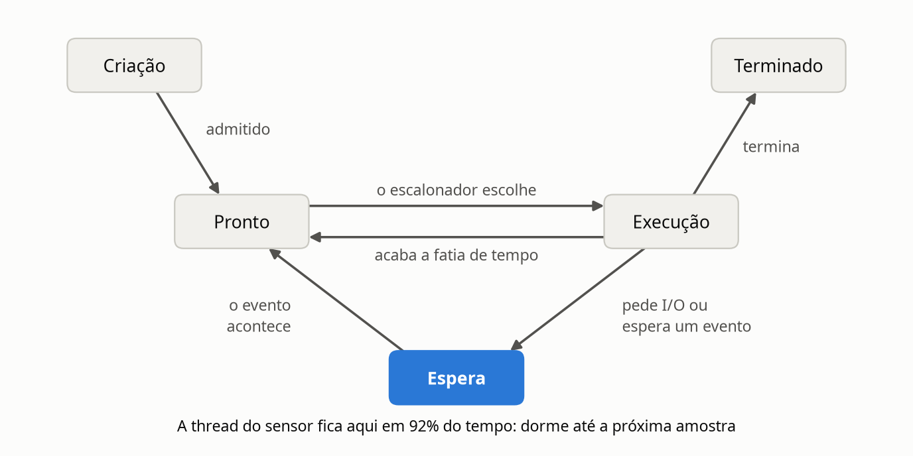

**A thread do sensor passa a maior parte do tempo em espera.** Ela trabalha por uma fração de cada período de 10 ms e dorme até a próxima amostra. Mesmo que toda a conta da amostra rodasse nela, seriam 0,798 ms de trabalho em 10 ms, ou seja, **92% do tempo em espera**.

Medi uma tarefa com esse perfil por 30 s, usando as contas `nvcsw` e `nivcsw` do PCB que aparecem no slide: 92% do tempo fora do processador, 3.000 saídas por conta própria e só 33 retiradas pelo sistema. É um processo I/O-bound de manual.

## A4. Código com semáforos: o buffer entre o sensor e o motor

Fiz em **C com pthreads**, a linguagem em que esse firmware seria escrito. Sem GIL, as duas threads rodam ao mesmo tempo em núcleos diferentes, e a corrida acontece de verdade. Cada versão roda com um comando, a partir de `ponderada/codigo`: `make v1`, `make v2` e `make v3`.

As três usam o mesmo `comum.h`, com a contabilidade, o vigia de 1 s e o relatório, para que a única diferença entre elas seja a sincronização. No código, a versão 3 é a versão 2 com duas linhas trocadas de lugar. `sem_wait` é o DOWN (P) e `sem_post` é o UP (V).

### Resultados das 9 execuções

N = 3 e 20.000 amostras. São as primeiras 9 execuções do script, sem seleção (`resultados/execucoes.txt`).

| Versão | Execução | Produzidas | Consumidas | Perdidas | Duplicadas | Travou? |
|---|---:|---:|---:|---:|---:|---|
| 1 | 1 | 19.016 | 20.000 | 3.648 | 3.648 | não |
| 1 | 2 | 10.295 | 20.000 | 10.090 | 10.090 | não |
| 1 | 3 | 20.000 | 12.558 | 8.306 | 864 | sim |
| 2 | 1 | 20.000 | 20.000 | 0 | 0 | não |
| 2 | 2 | 20.000 | 20.000 | 0 | 0 | não |
| 2 | 3 | 20.000 | 20.000 | 0 | 0 | não |
| 3 | 1 | 3 | 0 | 20.000 | 0 | sim |
| 3 | 2 | 3 | 0 | 20.000 | 0 | sim |
| 3 | 3 | 3 | 0 | 20.000 | 0 | sim |

Perdida é um número de 0 a 19.999 que o consumidor nunca viu. Duplicada é cada recebimento além do primeiro. A coluna **Produzidas** é um acréscimo meu, porque parte das perdidas nem chegou a existir: na execução 2 da versão 1, o consumidor "completou" 20.000 leituras com o sensor ainda na amostra 10.295.

Duas das três execuções da versão 1 terminaram sem travar e com 20.000 recebimentos. Quem olhasse só para isso diria que estão corretas, mas 18% e 50% dos recebimentos eram repetição.

**Versão 1**

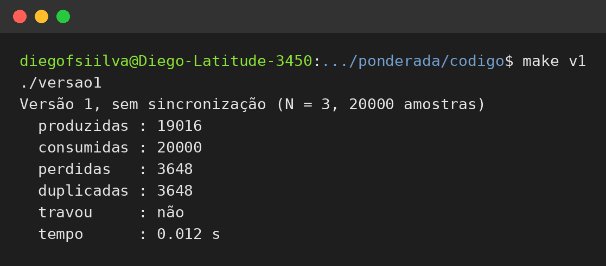

**Versão 2**

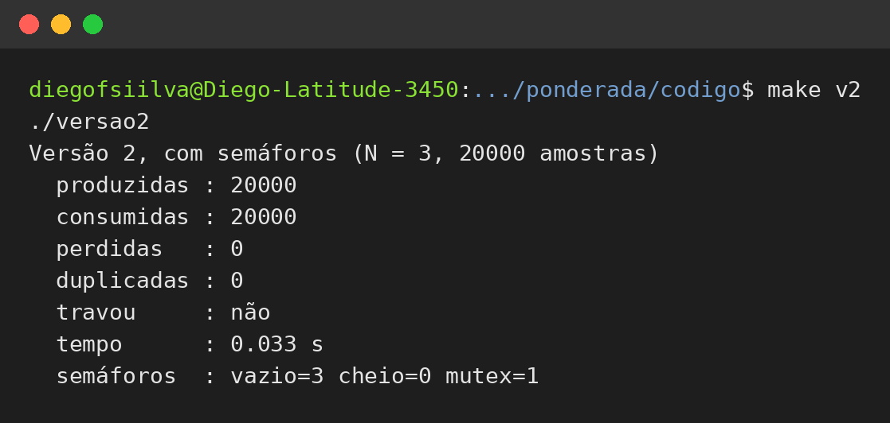

**Versão 3**

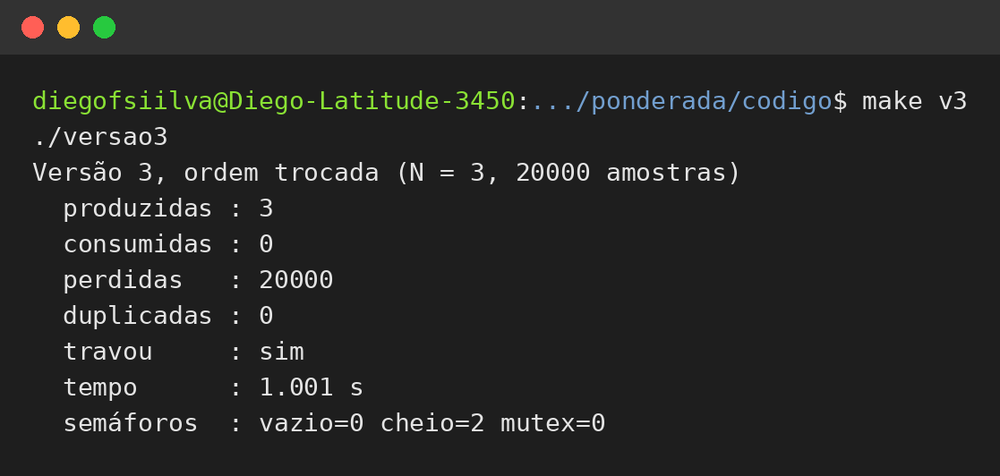

### Versão 1: a região crítica

A região crítica é o trecho que testa e altera o estado compartilhado: o teste de `ocupadas`, o acesso à posição do buffer e, principalmente, o par `lido = ocupadas` e `ocupadas = lido ± 1`. Se a outra thread entra entre a leitura e a escrita, o valor gravado sai de uma leitura velha e a atualização dela some. É o LOAD, ADD e STORE da aula, agora nas duas direções.

```c
int lido = ocupadas;     /* ler */
sched_yield();           /* a outra thread pode entrar aqui */
ocupadas = lido + 1;     /* escrever um valor que pode já estar velho */
```

**Por que duplica.** Partindo de `ocupadas = 1`, o decremento do consumidor é perdido e o contador fica **acima** da realidade:

| Passo | Thread | Instrução | `ocupadas` | Não lidas de verdade |
|---:|---|---|---:|---:|
| 1 | Produtor | grava a amostra; `lido = ocupadas` (1) | 1 | 2 |
| 2 | Consumidor | lê a amostra; `lido = ocupadas` (1) | 1 | 1 |
| 3 | Consumidor | `ocupadas = lido - 1` | 0 | 1 |
| 4 | Produtor | `ocupadas = lido + 1` | **2** | 1 |

O contador diz 2, mas só existe uma amostra nova. O consumidor lê essa amostra e, ainda vendo `ocupadas = 1`, avança para uma posição antiga e lê de novo o que já tinha lido.

**Por que perde.** Agora o incremento do produtor é perdido e o contador fica **abaixo** da realidade:

| Passo | Thread | Instrução | `ocupadas` | Não lidas de verdade |
|---:|---|---|---:|---:|
| 1 | Consumidor | lê a amostra; `lido = ocupadas` (1) | 1 | 0 |
| 2 | Produtor | grava a amostra; `lido = ocupadas` (1) | 1 | 1 |
| 3 | Produtor | `ocupadas = lido + 1` | 2 | 1 |
| 4 | Consumidor | `ocupadas = lido - 1` | **0** | 1 |

O contador diz que o buffer está vazio, mas há uma amostra por ler. O produtor acredita ter 3 posições livres, dá a volta no buffer e, se o consumidor demorar, grava por cima dela. Se o contador terminar assim, depois que o produtor acabar, o consumidor fica esperando amostras que não virão, e o vigia registra o travamento.

**Evidência independente.** O ThreadSanitizer acompanha cada acesso à memória e aponta exatamente essas variáveis: `ocupadas` (linhas 43, 64 e 72 de `versao1.c`) e `buffer` (linhas 38 e 67). O terceiro aviso é a atualização perdida em pessoa: as duas threads escrevendo no mesmo contador, nas linhas 43 e 72. Na versão 2, ele não encontra nenhuma corrida.

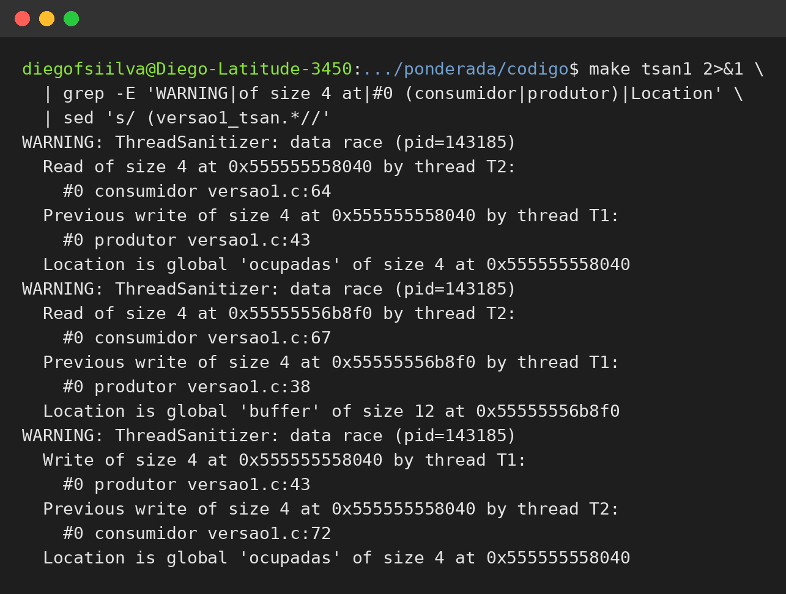

### Três execuções não provam nada

Repeti cada versão muitas vezes, em vários núcleos e presa a um só:

| Cenário | Execuções | Sem erro | Travaram | Perdidas (mín. a máx.) | Duplicadas (mín. a máx.) | Tempo mediano |
|---|---:|---:|---:|---:|---:|---:|
| Versão 1, vários núcleos | 200 | 0 | 89 | 1.398 a 13.238 | 7 a 13.238 | 0,012 s |
| Versão 1, um núcleo | 20 | 11 | 5 | 0 a 117 | 0 a 6 | 29,7 s |
| Versão 2, vários núcleos | 200 | 200 | 0 | 0 | 0 | 0,036 s |
| Versão 2, um núcleo | 20 | 20 | 0 | 0 | 0 | 0,033 s |
| Versão 3, vários núcleos | 100 | 0 | 100 | 20.000 | 0 | 1,001 s |
| Versão 3, um núcleo | 20 | 0 | 20 | 20.000 | 0 | 1,000 s |

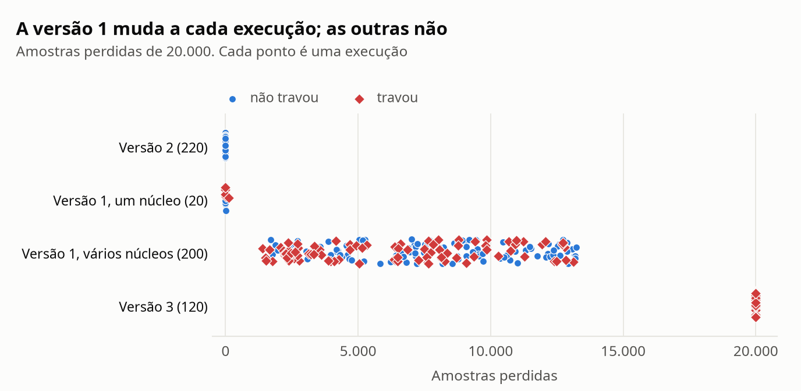

A versão 2 nunca errou e a versão 3 nunca escapou. O problema é a versão 1: em vários núcleos, nenhuma das 200 execuções saiu certa, e as perdas foram de 1.398 a 13.238.

Presa a um núcleo, como em uma pulseira com um processador só, ela erra bem menos: 11 das 20 execuções saíram perfeitas. Com essa taxa, três execuções limpas seguidas acontecem em uma de cada seis tentativas, e foi o que aconteceu comigo. Minhas três primeiras nesse cenário não mostraram erro nenhum, e eu quase escrevi que o código funcionava em um núcleo. É a armadilha do slide, "o teste passou, então não tem condição de corrida". A corrida continua lá, só ficou mais rara.

O núcleo único cobra outra conta. Quem gira na espera ocupada gasta o tempo de quem tem trabalho a fazer: a versão 1 levou 29,7 s, contra 0,033 s da versão 2, mais de 900 vezes mais. São 1,5 ms por amostra, 30% do orçamento de 5 ms, gastos em um laço vazio.

### Versão 2: o que cada semáforo garante

| Semáforo | Começa em | O que garante |
|---|---:|---|
| `vazio` | N = 3 | O produtor nunca grava em uma posição ainda não lida: com o buffer cheio, ele dorme. Elimina as perdas. |
| `cheio` | 0 | O consumidor nunca lê uma posição sem amostra nova: com o buffer vazio, ele dorme, sem gastar CPU. Elimina as duplicadas. |
| `mutex` | 1 | Exclusão mútua: só uma thread por vez mexe no buffer e nos índices. |

Testes mostram que a versão 2 funcionou. Para mostrar que ela não pode travar, o `verificador.py` percorreu todos os estados alcançáveis: **38 estados e nenhum deadlock**, em qualquer intercalação. O mesmo vale para os outros tamanhos que testei, até N = 64.

Um detalhe que encontrei ao testar: com **um** produtor e **um** consumidor, `vazio` e `cheio` já mantêm as duas threads em posições diferentes. Tirei o `mutex` de uma cópia da versão 2 e, em 200 execuções e no ThreadSanitizer, não houve nenhum erro. Com duas threads de um mesmo lado, ele volta a ser indispensável, porque elas dividiriam o índice. Neste caso, o semáforo que causa o deadlock da versão 3 poderia nem existir.

### Versão 3: o que aconteceu

Esta é a diferença entre as duas versões, além do título e dos comentários:

```diff
-        sem_wait(&vazio);
         sem_wait(&mutex);
+        sem_wait(&vazio);
```

**Deadlock, em todas as execuções.** O relatório já conta a história nos valores finais, `vazio=0 cheio=2 mutex=0`:

1. O produtor enche as 3 posições e `vazio` chega a 0.
2. Na quarta amostra, ele faz DOWN(mutex), consegue, e dorme em DOWN(vazio) **segurando o mutex**.
3. O consumidor faz DOWN(cheio), que cai de 3 para 2, e dorme em DOWN(mutex).
4. Só o consumidor pode fazer UP(vazio), mas ele está antes desse ponto, preso no mutex. Só o produtor pode fazer UP(mutex), mas ele está preso em `vazio`.

O gdb confirma, com as duas threads paradas no momento em que o vigia dispara: o consumidor dorme em `<mutex>` (`versao3.c:63`) e o produtor, em `<vazio>` (`versao3.c:36`).

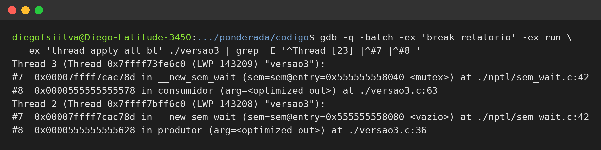

É o mesmo defeito da A5, com um detalhe que engana: as duas threads estão dormindo, sem gastar CPU. Um deadlock não aparece como carga alta nem como erro. É silêncio, e por isso o vigia olha para o progresso.

**Aumentar o buffer não resolve.** O verificador encontra o deadlock em todos os tamanhos testados, até N = 64. Um buffer maior só aumenta o caminho até ele, que tem 4N + 2 passos.

### O ritmo real esconde o defeito

Na versão 3, 100% de travamento pareceu fácil demais. O motivo é que as versões correm na velocidade máxima, e o produtor enche o buffer antes de o consumidor começar. Na pulseira, o sensor gera uma amostra a cada 10 ms. Por isso, `extras/ritmo.c` roda o mesmo buffer a 100 Hz, com o motor levando 0,8 ms por amostra e uma pausa opcional:

| Cenário a 100 Hz | Consumidas | Travou? | Latência máxima | Acima de 5 ms |
|---|---:|---|---:|---:|
| Versão 3, sem pausa | 20.000 | não | 3,99 ms | 0 |
| Versão 3, pausa de 20 ms no motor | 20.000 | não | 20,98 ms | 2 |
| Versão 3, pausa de 50 ms no motor | 1.001 | **sim** | 50,95 ms | 1 |
| Versão 2, pausa de 50 ms no motor | 20.000 | não | 51,04 ms | 5 |

Este é o resultado mais importante da A4. **No ritmo real, a versão 3 passa 200 s de teste sem travar**, porque o buffer quase nunca enche. Basta uma pausa do motor longa o bastante para acumular 3 amostras e chegar a quarta, entre 30 e 40 ms pela conta, para a pulseira congelar para sempre. Com a mesma pausa, a versão 2 atrasa 5 amostras e volta ao normal sozinha.

É assim que um defeito desses chega ao cliente: ele precisa de um azar raro, e o efeito é permanente.

### O que N = 3 custa em prazo

Buffer maior não é só mais seguro. Se o processamento roda depois do buffer e ele está cheio, a última amostra espera as outras e leva N × tempo por amostra para ficar pronta. Com N = 3, só a H com DSP cabe nos 5 ms (tabela da A1): a H leva 9,375 ms e a V, 5,395 ms no pior caso. **Um buffer troca perda por atraso**, e em um aviso de obstáculo uma amostra velha vale pouco.

## A5. Deadlock: a pulseira congelou

### 1. Uma sequência que leva ao deadlock

| Passo | Thread | Operação | O que acontece |
|---|---|---|---|
| 1 | `thread_sensor` | P(i2c) | Consegue e entra em `le_sensor()`. |
| 2 | `thread_log` | P(log) | Consegue e entra em `le_log()`. |
| 3 | `thread_config` | P(ble) | Consegue e entra em `recebe_comando()`. |
| 4 | `thread_sensor` | P(log) | Dorme: `log` está com `thread_log`. |
| 5 | `thread_log` | P(ble) | Dorme: `ble` está com `thread_config`. |
| 6 | `thread_config` | P(i2c) | Dorme: `i2c` está com `thread_sensor`. |

Grafo de alocação nesse instante, na notação da aula: seta do recurso à thread indica "está com ela", e seta da thread ao recurso indica "está pedindo".

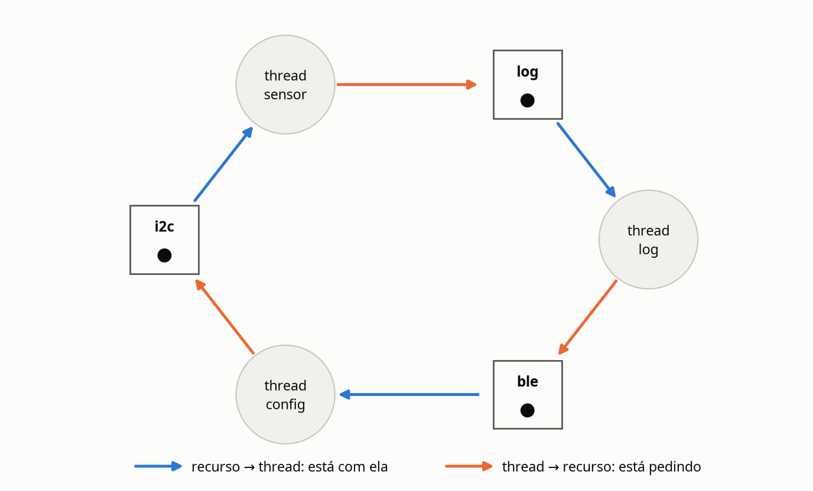

O ciclo é `thread_sensor → log → thread_log → ble → thread_config → i2c → thread_sensor`. Cada recurso tem uma unidade só, então, aqui, ciclo significa deadlock.

O `verificador.py` percorreu todos os estados do código: são 35 alcançáveis, e 1 é deadlock. Considerando uma rodada de cada thread, existem 168 execuções possíveis e **só 6 travam (3,6%)**: as 6 ordens em que as três threads pegam o primeiro recurso antes de qualquer uma pedir o segundo. Na prática, a janela é ainda menor, porque cada thread solta tudo em instantes. É por isso que o teste passa e o cliente encontra o defeito.

### 2. As quatro condições nesse código

| Condição | Onde aparece |
|---|---|
| Exclusão mútua | Cada semáforo começa em 1: o I2C, o log e o rádio atendem uma thread por vez. |
| Espera por recurso | `thread_sensor` segura `i2c` em P(log), `thread_log` segura `log` em P(ble) e `thread_config` segura `ble` em P(i2c). |
| Não preempção | Ninguém toma um semáforo de outra thread: só quem fez o P faz o V, e P não tem prazo. |
| Espera circular | `thread_sensor` espera `thread_log`, que espera `thread_config`, que espera `thread_sensor`. |

### 3. Duas correções de tipos diferentes

**Prevenção: um recurso por vez.** Quebra a espera por recurso. Nenhuma thread pede um recurso segurando outro, e o dado passa de um trecho ao outro por uma variável local:

```text
thread_sensor:        thread_log:           thread_config:
  P(i2c)                P(log)                P(ble)
  le_sensor()           le_log()              recebe_comando()
  V(i2c)                V(log)                V(ble)
  P(log)                P(ble)                P(i2c)
  registra()            envia()               ajusta_sensor()
  V(log)                V(ble)                V(i2c)
```

O verificador confirma: 52 estados alcançáveis e 0 deadlocks. **Para quem usa, nada muda**, e isso é o melhor resultado possível. Ainda há um ganho: o sensor deixa de depender do log para soltar o barramento.

A correção de livro seria a ordem global (`i2c`, depois `log`, depois `ble`). Ela também zera os deadlocks (24 estados, 0 deadlocks), mas eu não a usaria aqui. Ela obriga `thread_config` a pegar o I2C **antes** do rádio, e o sensor ficaria parado durante todo o `recebe_comando()`. Na especificação tradicional do BLE, o intervalo de conexão é de [no mínimo 7,5 ms](https://www.novelbits.io/ble-connection-intervals/), mais que os 5 ms do prazo. Eu trocaria um travamento raro por um atraso a cada comando recebido.

**Detecção e recuperação: watchdog de hardware.** A thread do sensor alimenta o watchdog a cada amostra. Se ele ficar sem sinal, reinicia a pulseira. Como o vigia da A4, ele olha para o progresso, não para a causa, e por isso cobre também os defeitos que ninguém descobriu ainda.

**Para quem usa, o apagão continua existindo, mas passa a ter fim.** A pessoa perde a vibração por alguns segundos e é avisada, em vez de andar sem proteção até perceber e desligar a pulseira.

As duas se completam: a prevenção remove o defeito conhecido, e o watchdog protege contra o desconhecido.

---

# Parte B: a decisão do CTO

**Memorando ao conselho da Tato. Dilema 3: o parceiro grande.**
De: Diego Figueiredo Silva, CTO

**Decisão: o módulo do parceiro só entra como processo separado, mesmo com o risco de perdermos o acordo.** Código fechado rodando como thread no nosso processo não vai para a pulseira.

**Do que abrimos mão.** Podemos perder a distribuição para 50 mil usuários, 25 vezes o lote do edital. Quem paga é a empresa, em receita e velocidade, e as pessoas que ficariam sem a pulseira se o acordo cair. O time também assume construir e manter a interface entre os processos.

**O número que pesou.** Na Plataforma V, meu pior caso é 3,80 ms: sobram **1,20 ms** dos 5 ms. A parceira diz que a comunicação entre processos gasta essa folga. Medi no meu notebook: a amostra chega a uma thread em 1,1 µs e a um processo em 1,2 µs (medianas de 50 mil mensagens). São 0,1 µs a mais, menos de 0,01% da folga, e menos de 0,1% mesmo em um chip dez vezes mais lento. Isso vale para a nossa contraproposta: um processo separado que lê as amostras em memória compartilhada somente leitura. A parceira fica com a latência de thread, e a MMU garante que ela não escreve.

**Por que thread não.** Com código fechado dentro do processo, o pior caso da pulseira passa a ser escrito por outra empresa, e eu deixo de poder assinar os 5 ms. Injetei três falhas em um módulo simulado, com um obstáculo a 0,8 m:

| Falha do módulo | Como thread | Como processo |
|---|---|---|
| Acesso indevido à memória | Pulseira morre: 100 de 300 amostras | 300 de 300, só o módulo morre |
| Escreve na amostra | 200 avisos falsos de caminho livre, sem nenhum erro | Escrita barrada, 300 de 300 |
| Segura a trava do buffer | Congela: 100 de 300 | 300 de 300 |

**Impacto e segurança.** Para quem usa, o aviso de navegação chega no mesmo tempo. Se o módulo falhar, a pessoa perde a navegação, nunca a vibração. O risco que fica é o canal entre os processos, que vira superfície de ataque, e o próprio Linux, porque processo separado não protege contra falha no kernel. Isolar a memória também não basta: dividir o núcleo com um processo de mesma prioridade subiu o atraso típico de 54 para 629 µs, 52% da folga. Por isso o módulo roda com prioridade mínima e sem acesso ao I2C e ao motor.

**O que me faria mudar de ideia.** Aceito thread só se duas coisas acontecerem juntas: a parceira abrir o código para auditoria e, medido na pulseira real, o canal custar mais de 600 µs no pior caso, metade da folga. E há um limite que vale nos dois modelos: se o módulo levar a taxa de falta da L1 acima de 14,74%, ele não entra, porque o prazo deixa de fechar.

---

# Referências

- MACHADO, F. B.; MAIA, L. P. *Arquitetura de sistemas operacionais*. 5. ed. Rio de Janeiro: LTC, 2013. Caps. 5, 6 e 7.
- COFFMAN, E. G.; ELPHICK, M. J.; SHOSHANI, A. System deadlocks. *Computing Surveys*, v. 3, n. 2, 1971.
- LUISI, J. CC08, Semanas 03 e 04: processos e threads; semáforos, sincronização e deadlocks. Slides da disciplina, 2026.
- GARBELINI, M. et al. [SweynTooth: Unleashing Mayhem over Bluetooth Low Energy](https://asset-group.github.io/disclosures/sweyntooth/). 2020.
- RED HAT. [BleedingTooth: Linux kernel Bluetooth vulnerabilities](https://access.redhat.com/security/vulnerabilities/BleedingTooth). 2020.
- NOVEL BITS. [BLE connection intervals](https://www.novelbits.io/ble-connection-intervals/).
